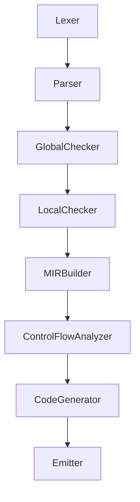

# Multiple File Compilation

This document describes how we will design our compiler to support multiple file compilation.
Multiple file compilation is a common feature in programming languages that allows developers to split their code into separate files for better organization and maintainability.
We will discuss how to compile multiple source files and how files can reference each other.

> [!WARNING]
> This document is a work in progress and may be subject to change.

## Introduction

For Nico to be practical for real-world use, it should support multiple file compilation. 
This means that developers can write their code in separate files and compile them together into a single executable or library.
Almost all general-purpose programming languages support multiple file compilation, and it is a feature that developers expect from a modern compiler.

There are different ways to implement multiple file compilation.
Traditionally, in C and C++, users write code in separate files that share a common interface through header files.
Header files are included using `#include` directives, which, more-or-less, copy the contents of the header file into the source file just before compilation.
Java takes a different approach, where each class is defined in its own file, and the compiler automatically resolves references between classes based on their names and package structure.
Python, on the other hand, uses a module system where each file is treated as a module, and imports are used to reference other modules.
Importing a Python file also executes the code in that file, which can lead to side effects if not managed carefully.

These strategies have their own advantages and disadvantages.
They can affect how users are allowed to organize their code, how much control users have over the compilation process, and how much work the compiler has to do to resolve references between files.
We will be exploring these strategies and their trade-offs in the context of Nico, and we will decide on the best approach for our compiler.

## Compilation units and LLVM modules

Before we discuss how to implement multiple file compilation, we need to understand the concepts of compilation units and LLVM modules.

A **compilation unit**, sometimes called a **translation unit**, is the smallest unit of code that the compiler can process to produce an output file.
Compilation units are important for multiple file compilation because they define the boundaries of what the compiler can compile at once.

An **LLVM module** is a container for all the information related to a single compilation unit. 
Because the Nico compiler uses LLVM, it is important to understand how compilation units and LLVM modules relate to each other.
One LLVM module produces one object file, which can be linked with other object files to produce an executable or a library.
To keep things simple, we'll consider a compilation unit to be a single LLVM module.

For this document, we'll use the following working definition of a project:
A **project** is a collection of source files that are to be compiled into a single target, an *executable* or a *library*.

A project may consist of one or more compilation units, and each compilation unit may consist of one or more source files.
If we design Nico such that a project is always a single compilation unit, we can greatly simplify the design of the compiler since we can put everything into a single LLVM module.
On the other hand, if we allow a project to consist of multiple compilation units, we will have to design a more complex system that can handle multiple LLVM modules and link them together.

Multiple compilation units have a huge advantage: they allow us to optimize the compilation process by compiling only the files that have changed since the last compilation.
For example, suppose a project consists of 10 compilation units, and the user makes changes that affect only 1 of those units. 
By compiling only the changed unit, we can save a lot of time compared to recompiling all 10 units.

## Structure of an LLVM module

According to the [LLVM Language Reference Manual](https://llvm.org/docs/LangRef.html#module-structure), an LLVM module consists of functions, global variables, symbol table entries, and metadata.
Shown here is an example of an LLVM module taken from the LLVM Language Reference Manual:
```llvm
; Declare the string constant as a global constant.
@.str = private unnamed_addr constant [13 x i8] c"hello world\0A\00"

; External declaration of the puts function
declare i32 @puts(ptr captures(none)) nounwind

; Definition of main function
define i32 @main() {
  ; Call puts function to write out the string to stdout.
  call i32 @puts(ptr @.str)
  ret i32 0
}

; Named metadata
!0 = !{i32 42, null, !"string"}
!foo = !{!0}
```

Here, we will focus on the *global values*, which are the *functions* and *global variables* in the module.
Global values are represented by a pointer to a memory location.
They may have a definition, or they may be undefined.
They can have different linkage types, which determine how they can be accessed from other modules.
The most common linkage types are `external`, `internal`, and `private`.
If a global value is only declared and not defined, it must have external or external-weak linkage.

When working with multiple LLVM modules, we must follow these rules:
1. To reference any global value, it must have been declared in the module that is referencing it.
2. If a global value is defined in one module, it must not be defined in any other module. It can only be declared in other modules.
3. If a global value is declared in one module, it can be used in any other module that declares it.

This is very similar to how C and C++ handle multiple file compilation, where a function or variable needs to be declared before it can be used.
In these languages, we use header files to ensure that declarations are available in all source files that need them.

Identified structure types are special: they aren't global values and don't allocate memory. 
Instead, they are used to define the layout of data structures in memory.
Here is an example of a structure type with the name `struct.Point` that has two fields of type `i32`:
```llvm
%struct.Point = type { i32, i32 }
```

We can't apply linkage types to structure types, but we can declare them in multiple modules with the same name and definition.
LLVM merges these declarations when linking modules together.

This is analogous to how C++ handles structure types; C++ programmers typically define the struct *in the header file* and include that header file in all source files that need to use the struct.
```cpp
struct Point {
    int x;
    int y;
};
```

## One source file is one compilation unit

There are a few options we can take when considering how many source files should be in a compilation unit:
1. All source files in a project are compiled together into a single compilation unit.
2. Groups of source files are compiled together into their own compilation units.
3. Each source file is compiled into its own compilation unit.

We should rule out option 1 because it would require the compiler to recompile all source files in a project whenever any file changes, which doesn't scale well for large projects.
There is a limit to how fast we can make our compiler, and projects can grow to be very large.
Nico *does* have the option to create external declarations, which allow one to split their code across libraries, but splitting code this way is not always practical.

We should also rule out option 2, because the user would then have to think about how to group their source files into compilation units, which is not a common practice in programming languages.
It also makes our compiler more complex because we would have to sort files into groups and groups into projects, which is not a trivial task.

This leaves us with option 3, which is the most common approach in programming languages.

## Key Point: Users should not have to manually write declarations

C and C++ require programmers to declare functions and variables before they can be used.
For example:
```cpp
int add(int a, int b); // Declaration

int main() {
    int result = add(2, 3); // Use of add function
    return 0;
}

int add(int a, int b) { // Definition
    return a + b;
}
```
In this example, the `add` function is declared before it is used in the `main` function, and it is defined later in the code.

Usually, programmers keep declarations in header files, where they can be included in multiple source files using the `#include` directive.
```cpp
#include "add.h" // Declaration of add function

int main() {
    int result = add(2, 3); // Use of add function
    return 0;
}

// Definition of add function is in its own implementation file, add.cpp
```

The `#include` directive is not like `import` statements in other programming languages, which are used to reference other files or modules.
`#include` is a preprocessor directive that copies the contents of the specified file into the source file before compilation.

This pattern of requiring programmers to manually write declarations is common in C and C++, but virtually all other modern programming languages have moved away from this requirement.
It's tedious to have to write declarations for every function and variable, and it can lead to errors if the declaration and definition don't match.
If we chose to require Nico programmers to manually write declarations, it would help simplify the design of our compiler as we wouldn't have to figure out how to automatically generate declarations, but it would make Nico less practical for real-world use and it goes against the expectations of modern programming languages.

Instead, we should create some kind of "import" system that allows Nico programmers to reference other files without having to manually write declarations.

## Key Idea: Imports produce declarations

> [!WARNING]
> The example code used in this section may not reflect the final design.

Suppose we have an import statement that looks like this:
```
import math::add
```

Here, the user knows that they want to use a function called `add` from the `math` namespace. 
They probably have an idea of what the declaration of the `add` function looks like, but they don't want to have to write it themselves.

If we recall the rules for working with multiple LLVM modules, we know that in order to reference a global value, it must have been declared in the module that is referencing it.
This means that when the compiler sees the `import` statement, it must generate a declaration for the `add` function in the current module, and that declaration must match the definition of the `add` function in the `math` module.

The key idea here is that imports produce declarations.

Question: How does the compiler know what the declaration of the `add` function looks like?

### Approach 1: Process files as they are imported

When the compiler sees an import statement, it can immediately process the imported file, scanning tokens, parsing them, and generating declarations for all the global values in that file.

This approach might make use of a specialized codegen pass that only generates declarations for global values, without generating any code for the definitions of those values.

**Pros:**
- We don't need to store any additional information about the imported file, since we can just process it on the spot.

**Cons:**
- If the imported file has its own imports, we have to process those files as well, which can lead to a lot of work being done at once.
- If the imported file has already been processed, we may end up processing it again, which is inefficient.
- Processing the file again means that we have to re-parse it and do at least some of the semantic analysis again. This extra time spent processing the file again is wasted time, and it can add up if the imported file is large or if there are many imports, effectively negating the benefits of multiple file compilation.
- The added specialized components for processing declarations may make the compiler more complex and harder to maintain.

### Approach 2: Store export information while compiling a file

This idea is somewhat similar to the concept of caching, where we store information about a file while it is being compiled so that we can use that information later without having to recompile the file.

When the compiler compiles a file, it may have a set of exported symbols, which are the global values that are defined in that file and can be referenced by other files.
These exported symbols are stored separately from the compiled file, and they can be used to generate declarations for the imported file without having to recompile it.

One can think of this approach like generating header files for each source file, where the header file contains the declarations of the exported symbols.
When a file is imported, the compiler can read the corresponding header file to generate the necessary declarations.

Unlike header files, however, we don't actually have to store this information as text data. We could store it in a binary format that is more efficient to read and write, and we could also include additional information that is useful for the compiler, such as type information and metadata.

If the compiler encounters an import statement for a file that has *not* been compiled yet, it can compile that file and store the export information for future use.

**Pros:**
- We don't have to recompile files that have already been compiled, which saves time and resources.
- We can store additional information about the exported symbols, which can be useful for the compiler and for other tools that work with the compiled files.
- Since export data is generated at the same time as normal compilation, we can reuse the same codegen passes and semantic analysis that we already have instead of creating specialized components for processing declarations, which simplifies the design of the compiler and makes it easier to maintain.

**Cons:**
- We have to store additional information about the exported symbols, which takes up disk space and may require additional management to ensure that the information is up-to-date and consistent with the source files.
- If the exported symbols change, we have to recompile the file and update the stored information, which can be a source of complexity and potential errors if not managed properly.
- We need to design a system for handling potential circular imports, where two or more files import each other, which can lead to complications in the compilation process.
- If we are using binary export data, we'd need a way to reliably read and write that data, which may require additional tooling or libraries.

------

**Decision:** We will use Approach 2, where we store export information while compiling a file.

We'll need to come up with a way to store the export information, serialize it, write the data to disk, and read it back in when we need to generate declarations for an imported file.

## Key Point: The global checker is the earliest stage that can generate interface data

Henceforth, we'll define **interface data** as the mimimum information that is required to generate declarations for imported files.
It is called *interface data* because it reveals the interface of a file to other files, without revealing the implementation details of that file.

The current design of the compiler looks something like this:


Note that the type checker is split into two stages: the global checker and the local checker.
The global checker checks what we call *declaration space*.

**Declaration space** is where declarations are processed.
This includes static variables, function headers, structs, classes, namespaces, external declaration namespaces, and exports.
Order does not matter in declaration space as long as all dependencies are satisfied by the end of the declaration space.

Once the global checker has finished its pass, all of declaration space will have been processed, and all declarations will be available for use in the local checker.
Note that interface data that we would use for our LLVM modules relies solely on code written in declaration space.
This means that the global checker is the earliest stage in the compiler that can generate interface data for imported files.

We still need to be careful, however. 
Currently, the global checker's check function looks like this:
```cpp
void GlobalChecker::run_check(std::unique_ptr<FrontendContext>& context) {
    symbol_tree->clear_modified();

    for (size_t i = context->stmts_processed; i < context->stmts.size(); ++i) {
        context->stmts[i]->accept(this);
    }

    symbol_tree->resolve_unresolved_types();

    if (Diagnostics::inst().get_errors().empty()) {
        context->status = Status::Ok();
    }
    else if (repl_mode) {
        if (symbol_tree->was_modified()) {
            context->status = Status::Pause(Request::DiscardWarn);
        }
        else {
            context->status = Status::Pause(Request::Discard);
        }
        context->rollback();
    }
    else {
        context->status = Status::Error();
    }
}
```

Note the call to `symbol_tree->resolve_unresolved_types()`.
We cannot generate interface data before this point, because we need to ensure that all types have been resolved.

Now, we don't actually need to make interface data generation a separate compiler stage. 
We can implement it as part of the global checker.
The global checker would then have *two responsibilities*: decorating the AST, and generating interface data for imported files.

## Modules and namespaces

Many programming languages have a feature that allows users to organize their code into groups, which have different names depending on the language.

- In C++, these groups are called *namespaces*, though later versions of C++ also have a *module* system.
- In Java, these groups are called *packages*.
- In Rust, these groups are called *modules*.

...

## Imports and exports

Here, we will discuss the syntax and semantics of imports and exports in Nico, and how they relate to generating interface data.
We'll start with exports.

### Exports

A source file may consist of multiple global values.
An export statement allows the programmer to specify which global values should be included in the interface data for that file.

This choice of using explicit export statements has a few benefits:
1. We don't need to expose all global values in a file, which can help with encapsulation and information hiding.
2. We can avoid potential name collisions between global values in different files, since we can choose which global values to export and which to keep private.
3. We can avoid generating interface data for global values that are not intended to be used by other files, which can help reduce the size of the interface data and improve compilation times.
4. The compiler does not have to do any extra work to determine which global values should be included in the interface data, since the programmer has explicitly specified which global values to export.

Explicit exports are also not without precedent. Many programming languages, such as Rust and JavaScript, use explicit exports to control which symbols are visible outside of a module or file.
```js
function add(a, b) {
    return a + b;
}

export { add };
```

We can implement something similar in Nico:
```
func add(a: i32, b: i32) -> i32 => a + b

func subtract(a: i32, b: i32) -> i32 => a - b

export { add, subtract }
```

We'll use braces to group exported symbols together, and we'll use commas to separate the names of the exported symbols.
Although we *could* allow lists without braces (like with print statements), that syntax becomes harder to use and read as the number of exported symbols increases.
And files can have *many* exported symbols, so we should make it easy to read and write export statements.

The exports of a file can be put into a single group, and the order of names within that group does not matter.
We do not necessarily have to process the export statement exactly where it appears in the source file.
Due to how the global checker works, we have to process exports at the very end anyway, we we can just *collect* the names of exported symbols as we process the file, and then generate the interface data at the end of the global checker's pass.

This also means that there is little restriction on where the export statement can appear in a source file, as long as it appears within declaration space.

**Question:** Can an export statement appear within a namespace?

That is, should we allow this?:
```
namespace math {
    func add(a: i32, b: i32) -> i32 => a + b
    func subtract(a: i32, b: i32) -> i32 => a - b
    export { add, subtract }
}
```

