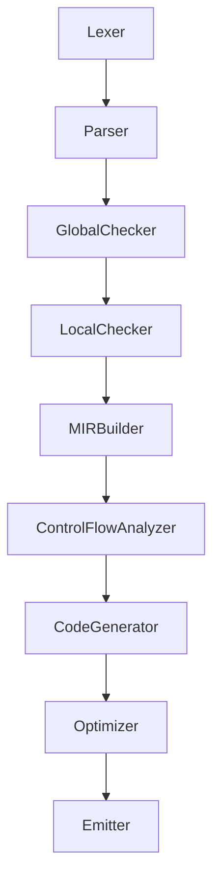
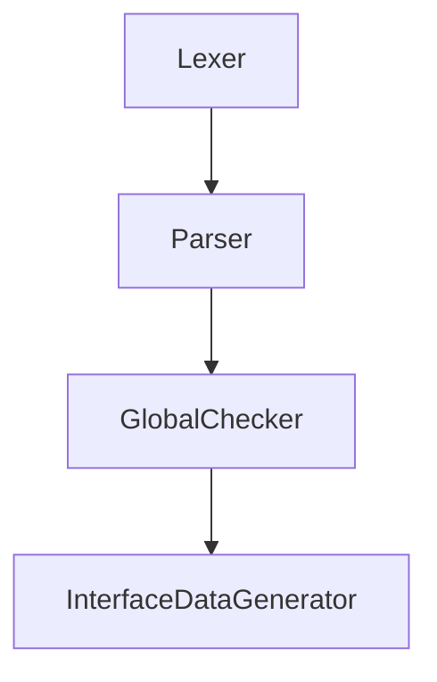

# Multiple File Compilation

This document describes how we will design our compiler to support multiple file compilation.
Multiple file compilation is a common feature in programming languages that allows developers to split their code into separate files for better organization and maintainability.
We will discuss how to compile multiple source files and how files can reference each other.

> [!WARNING]
> This document is a work in progress and may be subject to change.

## Introduction

For Nico to be practical for real-world use, it should support multiple file compilation. 
This means that developers can write their code in separate files and compile them together into a single executable or library.
Almost all general-purpose programming languages support multiple file compilation, and it is a feature that developers expect from a modern compiler.

There are different ways to implement multiple file compilation.
Traditionally, in C and C++, users write code in separate files that share a common interface through header files.
Header files are included using `#include` directives, which, more-or-less, copy the contents of the header file into the source file just before compilation.
Java takes a different approach, where each class is defined in its own file, and the compiler automatically resolves references between classes based on their names and package structure.
Python, on the other hand, uses a module system where each file is treated as a module, and imports are used to reference other modules.
Importing a Python file also executes the code in that file, which can lead to side effects if not managed carefully.

These strategies have their own advantages and disadvantages.
They can affect how users are allowed to organize their code, how much control users have over the compilation process, and how much work the compiler has to do to resolve references between files.
We will be exploring these strategies and their trade-offs in the context of Nico, and we will decide on the best approach for our compiler.

## Compilation units and LLVM modules

Before we discuss how to implement multiple file compilation, we need to understand the concepts of compilation units and LLVM modules.

A **compilation unit**, sometimes called a **translation unit**, is the smallest unit of code that the compiler can process to produce an output file.
Compilation units are important for multiple file compilation because they define the boundaries of what the compiler can compile at once.

An **LLVM module** is a container for all the information related to a single compilation unit. 
Because the Nico compiler uses LLVM, it is important to understand how compilation units and LLVM modules relate to each other.
One LLVM module produces one object file, which can be linked with other object files to produce an executable or a library.
To keep things simple, we'll consider a compilation unit to be a single LLVM module.

For this document, we'll use the following working definition of a project:
A **project** is a collection of source files that are to be compiled into a single target, an *executable* or a *library*.

A project may consist of one or more compilation units, and each compilation unit may consist of one or more source files.
If we design Nico such that a project is always a single compilation unit, we can greatly simplify the design of the compiler since we can put everything into a single LLVM module.
On the other hand, if we allow a project to consist of multiple compilation units, we will have to design a more complex system that can handle multiple LLVM modules and link them together.

Multiple compilation units have a huge advantage: they allow us to optimize the compilation process by compiling only the files that have changed since the last compilation.
For example, suppose a project consists of 10 compilation units, and the user makes changes that affect only 1 of those units. 
By compiling only the changed unit, we can save a lot of time compared to recompiling all 10 units.


## Structured and unstructured projects

When designing a build system for a programming language, we should acknowledge that there are certain things a build system can only do if it understands the structure of a project.
If the build system understands the full scope of a project, it can more effectively manage the compilation process, including determining which files need to be recompiled and how to link the resulting object files together.

Build systems for existing programming languages, such as CMake for C/C++ and Cargo for Rust, are able to manage the compilation process because they understand the structure of a project (with the help of configuration files, such as `CMakeLists.txt` and `Cargo.toml`).

Thus, we distinguish between two types of projects: *structured* and *unstructured*.

An **unstructured project** is a project that does not have a recognizable structure, which the build system cannot understand or use to manage the compilation process.

A **structured project** is a project that has a recognizable structure, which the build system can understand and use to manage the compilation process.

A requirement for a project to be considered structured is that it must have a clear and unambiguous *root directory* that defines the boundaries of the project.
This root directory may be signaled by a configuration or manifest file that describes the project and its dependencies.
The compiler uses this information to determine which files belong to the project and how they should be compiled and linked together.

Additionally, with structured projects, the compiler has a dedicated space to store build artifacts, such as compiled object files and interface data.

This concept is important because want to start with a simple design for the compiler that can handle unstructured projects, and then later extend the design to support structured projects.
Creating a build system for structured projects is a complex task and will likely be discussed in a future design document.
We want to avoid making the compiler more complex than it needs to be in the early stages of development.


## Structure of an LLVM module

According to the [LLVM Language Reference Manual](https://llvm.org/docs/LangRef.html#module-structure), an LLVM module consists of functions, global variables, symbol table entries, and metadata.
Shown here is an example of an LLVM module taken from the LLVM Language Reference Manual:
```llvm
; Declare the string constant as a global constant.
@.str = private unnamed_addr constant [13 x i8] c"hello world\0A\00"

; External declaration of the puts function
declare i32 @puts(ptr captures(none)) nounwind

; Definition of main function
define i32 @main() {
  ; Call puts function to write out the string to stdout.
  call i32 @puts(ptr @.str)
  ret i32 0
}

; Named metadata
!0 = !{i32 42, null, !"string"}
!foo = !{!0}
```

Here, we will focus on the *global values*, which are the *functions* and *global variables* in the module.
Global values are represented by a pointer to a memory location.
They may have a definition, or they may be undefined.
They can have different linkage types, which determine how they can be accessed from other modules.
The most common linkage types are `external`, `internal`, and `private`.
If a global value is only declared and not defined, it must have external or external-weak linkage.

When working with multiple LLVM modules, we must follow these rules:
1. To reference any global value, it must have been declared in the module that is referencing it.
2. If a global value is defined in one module, it must not be defined in any other module. It can only be declared in other modules.
3. If a global value is declared in one module, it can be used in any other module that declares it.

This is very similar to how C and C++ handle multiple file compilation, where a function or variable needs to be declared before it can be used.
In these languages, we use header files to ensure that declarations are available in all source files that need them.

Identified structure types are special: they aren't global values and don't allocate memory. 
Instead, they are used to define the layout of data structures in memory.
Here is an example of a structure type with the name `struct.Point` that has two fields of type `i32`:
```llvm
%struct.Point = type { i32, i32 }
```

We can't apply linkage types to structure types, but we can declare them in multiple modules with the same name and definition.
LLVM merges these declarations when linking modules together.

This is analogous to how C++ handles structure types; C++ programmers typically define the struct *in the header file* and include that header file in all source files that need to use the struct.
```cpp
struct Point {
    int x;
    int y;
};
```

Note: LLVM modules also have *names*, which are metadata that can be used to identify the module.
However, the name of a module does *not* need to be unique when linking multiple modules together, and it is not used to reference global values in other modules.

## One source file is one compilation unit

There are a few options we can take when considering how many source files should be in a compilation unit:
1. All source files in a project are compiled together into a single compilation unit.
2. Groups of source files are compiled together into their own compilation units.
3. Each source file is compiled into its own compilation unit.

We should rule out option 1 because it would require the compiler to recompile all source files in a project whenever any file changes, which doesn't scale well for large projects.
There is a limit to how fast we can make our compiler, and projects can grow to be very large.
Nico *does* have the option to create external declarations, which allow one to split their code across libraries, but splitting code this way is not always practical.

We should also rule out option 2, because the user would then have to think about how to group their source files into compilation units, which is not a common practice in programming languages.
It also makes our compiler more complex because we would have to sort files into groups and groups into projects, which is not a trivial task.

This leaves us with option 3, which is the most common approach in programming languages.


## Key Point: Users should not have to manually write declarations

C and C++ require programmers to declare functions and variables before they can be used.
For example:
```cpp
int add(int a, int b); // Declaration

int main() {
    int result = add(2, 3); // Use of add function
    return 0;
}

int add(int a, int b) { // Definition
    return a + b;
}
```
In this example, the `add` function is declared before it is used in the `main` function, and it is defined later in the code.

Usually, programmers keep declarations in header files, where they can be included in multiple source files using the `#include` directive.
```cpp
#include "add.h" // Declaration of add function

int main() {
    int result = add(2, 3); // Use of add function
    return 0;
}

// Definition of add function is in its own implementation file, add.cpp
```

The `#include` directive is not like `import` statements in other programming languages, which are used to reference other files or modules.
`#include` is a preprocessor directive that copies the contents of the specified file into the source file before compilation.

This pattern of requiring programmers to manually write declarations is common in C and C++, but virtually all other modern programming languages have moved away from this requirement.
It's tedious to have to write declarations for every function and variable, and it can lead to errors if the declaration and definition don't match.
If we chose to require Nico programmers to manually write declarations, it would help simplify the design of our compiler as we wouldn't have to figure out how to automatically generate declarations, but it would make Nico less practical for real-world use and it goes against the expectations of modern programming languages.

Instead, we should create some kind of "import" system that allows Nico programmers to reference other files without having to manually write declarations.

## Key Idea: Imports produce declarations

> [!WARNING]
> The example code used in this section may not reflect the final design.

Suppose we have an import statement that looks like this:
```
import math::add
```

Here, the user knows that they want to use a function called `add` from the `math` namespace. 
They probably have an idea of what the declaration of the `add` function looks like, but they don't want to have to write it themselves.

If we recall the rules for working with multiple LLVM modules, we know that in order to reference a global value, it must have been declared in the module that is referencing it.
This means that when the compiler sees the `import` statement, it must generate a declaration for the `add` function in the current module, and that declaration must match the definition of the `add` function in the `math` module.

The key idea here is that imports produce declarations.

Question: How does the compiler know what the declaration of the `add` function looks like?

### Approach 1: Process files as they are imported

When the compiler sees an import statement, it can immediately process the imported file, scanning tokens, parsing them, and generating declarations for all the global values in that file.

This approach might make use of a specialized codegen pass that only generates declarations for global values, without generating any code for the definitions of those values.

**Pros:**
- We don't need to store any additional information about the imported file, since we can just process it on the spot.

**Cons:**
- If the imported file has its own imports, we have to process those files as well, which can lead to a lot of work being done at once.
- If the imported file has already been processed, we may end up processing it again, which is inefficient.
- Processing the file again means that we have to re-parse it and do at least some of the semantic analysis again. This extra time spent processing the file again is wasted time, and it can add up if the imported file is large or if there are many imports, effectively negating the benefits of multiple file compilation.
- The added specialized components for processing declarations may make the compiler more complex and harder to maintain.

### Approach 2: Store export information while compiling a file

This idea is somewhat similar to the concept of caching, where we store information about a file while it is being compiled so that we can use that information later without having to recompile the file.

When the compiler compiles a file, it may have a set of exported symbols, which are the global values that are defined in that file and can be referenced by other files.
These exported symbols are stored separately from the compiled file, and they can be used to generate declarations for the imported file without having to recompile it.

One can think of this approach like generating header files for each source file, where the header file contains the declarations of the exported symbols.
When a file is imported, the compiler can read the corresponding header file to generate the necessary declarations.

Unlike header files, however, we don't actually have to store this information as text data. We could store it in a binary format that is more efficient to read and write, and we could also include additional information that is useful for the compiler, such as type information and metadata.

If the compiler encounters an import statement for a file that has *not* been compiled yet, it can compile that file and store the export information for future use.

**Pros:**
- We don't have to recompile files that have already been compiled, which saves time and resources.
- We can store additional information about the exported symbols, which can be useful for the compiler and for other tools that work with the compiled files.
- Since export data is generated at the same time as normal compilation, we can reuse the same codegen passes and semantic analysis that we already have instead of creating specialized components for processing declarations, which simplifies the design of the compiler and makes it easier to maintain.

**Cons:**
- We have to store additional information about the exported symbols, which takes up disk space and may require additional management to ensure that the information is up-to-date and consistent with the source files.
- If the exported symbols change, we have to recompile the file and update the stored information, which can be a source of complexity and potential errors if not managed properly.
- We need to design a system for handling potential circular imports, where two or more files import each other, which can lead to complications in the compilation process.
- If we are using binary export data, we'd need a way to reliably read and write that data, which may require additional tooling or libraries.

------

**Decision:** We can use both approaches.
Although approach 2 is more efficient, we would need a space to store the exported interface data, and we would need to come up with a way to manage that data.
This works well for structured projects, where the compiler recognizes the structure of a project and can create a space for storing build artifacts,
but it doesn't work well when there is no project structure or when the compiler is used in REPL mode.

For unstructured projects, we use approach 1.
For structured projects, we use approach 2.

For approach 1, we need to keep things simple and avoid wasting time processing files that have already been processed.
If multiple files are being compiled at once, we can retain the interface data in memory and use it to generate declarations for imported files.

For approach 2, we'll need to come up with a way to store the export information, serialize it, write the data to disk, and read it back in when we need to generate declarations for an imported file.

This use of both approaches allows us to support both unstructured and structured projects, which aligns with our design philosophy of keeping things simple, but also allowing for flexibility.


## Key Point: The global checker is the earliest stage that can generate interface data

Henceforth, we'll define **interface data** as the mimimum information that is required to generate declarations for imported files.
It is called *interface data* because it reveals the interface of a file to other files, without revealing the implementation details of that file.

The current design of the compiler looks something like this:


Note that the type checker is split into two stages: the global checker and the local checker.
The global checker checks what we call *declaration space*.

**Declaration space** is where declarations are processed.
This includes static variables, function headers, structs, classes, namespaces, external declaration namespaces, and exports.
Order does not matter in declaration space as long as all dependencies are satisfied by the end of the declaration space.

Once the global checker has finished its pass, all of declaration space will have been processed, and all declarations will be available for use in the local checker.
Note that interface data that we would use for our LLVM modules relies solely on code written in declaration space.
This means that the global checker is the earliest stage in the compiler that can generate interface data for imported files.

We still need to be careful, however. 
Currently, the global checker's check function looks like this:
```cpp
void GlobalChecker::run_check(std::unique_ptr<FrontendContext>& context) {
    symbol_tree->clear_modified();

    for (size_t i = context->stmts_processed; i < context->stmts.size(); ++i) {
        context->stmts[i]->accept(this);
    }

    symbol_tree->resolve_unresolved_types();

    if (Diagnostics::inst().get_errors().empty()) {
        context->status = Status::Ok();
    }
    else if (repl_mode) {
        if (symbol_tree->was_modified()) {
            context->status = Status::Pause(Request::DiscardWarn);
        }
        else {
            context->status = Status::Pause(Request::Discard);
        }
        context->rollback();
    }
    else {
        context->status = Status::Error();
    }
}
```

Note the call to `symbol_tree->resolve_unresolved_types()`.
We cannot generate interface data before this point, because we need to ensure that all types have been resolved.

Now, we don't actually need to make interface data generation a separate compiler stage. 
We can implement it as part of the global checker.
The global checker would then have *two responsibilities*: decorating the AST, and generating interface data for imported files.


## Key Point: The frontend class manages all the frontend stages of the compiler

In the previous section, we discussed the different stages of the compiler and how they create a complete flow from source code to machine instructions.

Everything from the lexer to the code generator is considered part of the *frontend* of the compiler.
The stages that optimize the IR generated from the frontend are considered the *middle-end* of the compiler.
The stages that emit machine instructions from the optimized IR are considered the *backend* of the compiler.

In the Nico project, we leverage LLVM to handle the middle-end and backend parts of the compiler, meaning most of the work we do is in the frontend.

Key to creating a frontend is managing the flow of the many stages of the frontend.
While the pipeline design of the compiler is effective, it needs to be managed carefully to ensure that each stage is executed in the correct order and that the output of one stage is properly passed to the next stage.
This is why we have the `Frontend` class and `FrontendContext` class, which manages the flow of the frontend stages and the data that is passed between them.

If we want to add interface data generation to our compiler, we need to modify the frontend to run only the necessary stages:


We could implement this as a special function in the `Frontend` class separate from the `compile` function and runs only the necessary stages to generate interface data.
The `GlobalChecker` can then use this function to generate interface data for imported files, without having to run the entire compilation process.


## Modules and namespaces

Many programming languages have a feature that allows users to organize their code into groups, which have different names depending on the language.

- In C++, these groups are called *namespaces*, though later versions of C++ also have a *module* system.
- In Java, these groups are called *packages*.
- In Rust, these groups are called *modules*.

To properly support multiple file compilation, we need to have some kind of grouping mechanism in Nico, since this will affect how users will import names, how users will be able to organize their code, and how code outside of a project can reference code inside of a project.

The following design is based on a combination of JavaScript imports and Python modules.

A **module** is a unit of code defined in a *single* source file.
That is, a module is one source file, and a source file is one module.
This neatly aligns with our decision to have one source file per compilation unit/LLVM module.

To import a module, you must specify its file path relative to the current file.
Because we allow source files to be AOT-compiled independently of each other and prefer to avoid having to scan the entire project for source files, the compiler will need to know where imports are located.

A **namespace** allows users to group related code together *within* a module.
A namespace can contain functions, variables, structs, classes, and other namespaces.
They achieve a similar effect to writing static declarations in a struct/class, but without actually creating a struct/class.
Namespaces can be imported like any other declaration.
Importantly, you *cannot* reopen a namespace once it has been closed.
You can define namespaces with the same name, but they are treated as separate namespaces, and they cannot be merged together.

With this design, namespaces are less useful than they are in C++ or C# since they cannot be reopened, but they still fulfill the role of grouping related code together and preventing name collisions.

A programmer may want to put multiple declarations in the same module while also splitting them across multiple files.
For example, a programmer may want to define a `math` module, even though it is split across multiple files, like this:
```
math/
    arithmetic.nico
    geometry.nico
    linear_algebra.nico
```

In such cases, we allow *re-exporting* of declarations from one module to another.
**Re-exporting** is the act of exporting an imported declaration, making it appear as if the import was defined in the current module.

For example, the `geometry.nico` file may have a function called `distance`, and the `arithmetic.nico` file may have a function called `add`.
Each could be referenced through their respective modules: `math::geometry::distance` and `math::arithmetic::add`.

With re-exporting, we can make it so that the `math` module exports both of these functions, allowing them to be referenced as `math::distance` and `math::add`.

This means that a single declaration can be referenced through multiple paths.

## Imports and exports

Here, we will discuss the syntax and semantics of imports and exports in Nico, and how they relate to generating interface data.
We'll start with exports.

### Exports

A source file may consist of multiple global values.
An export statement allows the programmer to specify which global values should be included in the interface data for that file.

This choice of using explicit export statements has a few benefits:
1. We don't need to expose all global values in a file, which can help with encapsulation and information hiding.
2. We can avoid potential name collisions between global values in different files, since we can choose which global values to export and which to keep private.
3. We can avoid generating interface data for global values that are not intended to be used by other files, which can help reduce the size of the interface data and improve compilation times.
4. The compiler does not have to do any extra work to determine which global values should be included in the interface data, since the programmer has explicitly specified which global values to export.

Explicit exports are also not without precedent. Many programming languages, such as Rust and JavaScript, use explicit exports to control which symbols are visible outside of a module or file.
```js
function add(a, b) {
    return a + b;
}

export { add };
```

We can implement something similar in Nico:
```
func add(a: i32, b: i32) -> i32 => a + b

func subtract(a: i32, b: i32) -> i32 => a - b

export { add, subtract }
```

We'll use braces to group exported symbols together, and we'll use commas to separate the names of the exported symbols.
Although we *could* allow lists without braces (like with print statements), that syntax becomes harder to use and read as the number of exported symbols increases.
And files can have *many* exported symbols, so we should make it easy to read and write export statements.

The exports of a file can be put into a single group, and the order of names within that group does not matter.
We do not necessarily have to process the export statement exactly where it appears in the source file.
Due to how the global checker works, we have to process exports at the very end anyway, we we can just *collect* the names of exported symbols as we process the file, and then generate the interface data at the end of the global checker's pass.

This also means that there is little restriction on where the export statement can appear in a source file, as long as it appears within declaration space.

**Question:** Can an export statement appear within a namespace?

That is, should we allow this?:
```
namespace arithmetic {
    func add(a: i32, b: i32) -> i32 => a + b
    func subtract(a: i32, b: i32) -> i32 => a - b
    export { add, subtract }
}
```

We should not allow this; exports affect the interface of a *module*, and, thus, should appear at the *module* level, which is the top level of a source file.

If the user wants to export a declaration in a namespace, they must make sure the name is properly qualified in the export statement:
```
export { arithmetic::add, arithmetic::subtract }
```

### Imports

Imports come in three forms: import lists, module imports, and wildcard imports.

To demonstrate how these forms work, let's consider a source file called `math.nico` that exports a namespace `arithmetic` containing two functions, `add` and `subtract`.
```
// math.nico
namespace arithmetic {
    func add(a: i32, b: i32) -> i32 => a + b
    func subtract(a: i32, b: i32) -> i32 => a - b
}

export { arithmetic::add, arithmetic::subtract }
```

**Import lists** allow the programmer to specify a list of names to import from a module.
```
import { arithmetic::add, arithmetic::subtract } from "math.nico"
```

When importing a qualified name, the programmer may henceforth refer to the imported declaration using the last part of the qualified name.
For example, if the programmer imports `arithmetic::add`, they can refer to it simply as `add` in their code.
And if the programmer imports `arithmetic`, then references to `add` must be qualified with `arithmetic`: `arithmetic::add`.


**Module imports** allow the programmer to import an entire module.
The import specifies a name for the module, and all imported declarations must be qualified with that name.
```
import "math.nico" as math

math::arithmetic::add(2, 3)
```

**Wildcard imports** are like module imports, importing everything that is exported from a module.
But unlike module imports, imported declarations do not need to be qualified with the module name.
```
import * from "math.nico"

arithmetic::add(2, 3)
```

We include this feature for convenience, and many programming languages have some feature like this.
Wildcard imports can be useful when a module exports many declarations, and the programmer wants to use all of them without having to write out a long list of names.
However, wildcard imports can lead to name collisions and make it harder to understand where a declaration is coming from, so we discourage their use in favor of import lists and module imports.

------

Name collisions may still occur with import lists and module imports, and they are semantic errors.
```
import "math.nico" as math
import { distance } from "geometry.nico"

namespace math {  // Error: name collision with imported module.
    // ... some code
}

func distance(a: Point, b: Point) -> f64 {  // Error: name collision with imported declaration.
    // ... some code
}
```

Importing effectively creates an *alias* for the imported declaration.
When we generate LLVM IR, we always use the *symbol* for the declaration.
That symbol must remain the same when we generate the declaration for imports, so that the imported declaration can be linked to the definition in the original module.
Therefore, interface data must be able to preserve *both* the hierarchy of namespaces and the symbols for declarations, so that users can properly reference imported declarations and the compiler can properly generate declarations for those imports.


## Key Point: Testing with multiple files demands an abstraction of the file system

When our type checkers process an import statement, they need to be able to find the file that is being imported.
We can implement this using the IO and filesystem libraries in C++, which allow us to locate and read files from the file system.
However, this alone would not make an effective design for testing, since we would have to create and manage files on the file system for each test case.

I generally prefer to avoid creating actual files on the disk for testing since it can be slow and difficult to manage.
Additionally, when tests fail or terminate unexpectedly, it can leave the file system in an inconsistent state, which can make it difficult to run tests again or to debug the issue.
It would be better to simulate the file system in memory, so that we can create and manage files for testing without having to create actual files on the disk.
Additionally, when tests fail or terminate unexpectedly, we can simply discard the in-memory file system and start fresh for the next test run.
We already create fake file objects for testing our JIT compiler, but we need something more robust for testing multiple file compilation.

We need an abstraction of the file system.
In other words, we need a class that hides the details of how files are stored and accessed and provides a simple interface for the compiler to use when looking up files.
Then, internally, the class can use the real file system or a fake file system for testing.
The fake file system works by storing source code in memory, and it can be used to simulate the behavior of the real file system without having to create actual files on disk.

The class could be designed something like this:
```cpp
class IFileSystem {
public:
    virtual ~IFileSystem() = default;

    virtual std::string read_file(const std::filesystem::path& path) const = 0;
    virtual bool file_exists(const std::filesystem::path& path) const = 0;
};
```

The in-memory file system can be implemented as a concrete subclass of `IFileSystem`, and it can store source code in a map or a vector, where the key is the file path and the value is the source code.
```cpp
class InMemoryFileSystem : public IFileSystem {
    std::unordered_map<std::filesystem::path, std::string> files;

public:
    InMemoryFileSystem() = default;

    void add_file(const std::filesystem::path& path, const std::string& source_code) {
        files[path] = source_code;
    }

    /* additional method implementations */
};
```

An unordered map is a good choice for storing files in memory, since it allows for fast lookups and insertions.

Because Nico source files reference each other using relative paths, we may need an additional function to "normalize" paths, which resolves relative paths to "absolute" paths.
For example, suppose a file `math/math.nico` imports from `../time/time.nico`.
When we process the import, we can determine that the path of `time.nico` can be represented as the path of the current directory plus the relative path of the imported file:
`math/../time/time.nico`.

The C++ filesystem library already has functions that can convert a path into a "lexically normal" path, which removes redundant elements such as `.` and `..` from the path.
`math/../time/time.nico` becomes `time/time.nico`, which is the path we can use to look up the file in our in-memory file system.
```cpp
std::string normalize(const std::filesystem::path& path) {
    return path.lexically_normal().generic_string();
}
```

Note that the `InMemoryFileSystem` class will need to be tested separately to ensure that it works correctly, since it is key to the testing of multiple file compilation.


## Reserved symbols

In Nico, a **symbol** or **unique symbol** is a globally unique string consisting of one or more parts and used internally by the compiler to refer to a variable/type/function.

Symbols are important in code generation because we can use them to ensure that the same variable/type/function is referred to consistently throughout the generated code.
Users generally won't see symbols and instead will use names to refer to variables/types/functions. 

Note that a symbol is not the same as a *fully qualified name*, which is a name that includes all of the namespaces and modules that a variable/type/function belongs to.
Users may use fully qualified names to refer to variables/types/functions, but the compiler will convert those names into symbols for internal use.

A **reserved symbol** is a type of reserved word that cannot be used as a symbol.
Users generally won't encounter symbol collisions due to how most symbols are constructed.
Most symbols start with `::`, which represents the root of the symbol tree.
However, there are a few instances where a user can control what symbol a declaration uses, such as with the `symbol` modifier or with external declarations (for linking to external libraries).

Currently, at the time of writing, the following symbols are reserved:
- `main` and `$main`: Used for the function that is called when a program starts.
- `$script`: Used for the function that runs all of a module's top-level execution space code.
- `$panicking`: Used for the global variable that indicates whether the program is currently panicking.

Reserved symbols are important for multiple file compilation because the compiler is responsible for their definition.
And as we've mentioned before, a global value can only be defined in one module, and it can only be declared in other modules.
If we define these reserved symbols in multiple modules, we will violate the one-definition rule and cause a linking error.


## Key point: For unstructured projects, we require unique module names

When a project is unstructured, the compiler does not have any knowledge of the structure of the project.
Because of this, the only way to ensure that all symbols are unique is to also require that all module names are unique.

This should be fairly obvious.
For example, if we have two source files, `a.nico` and `b.nico`, and both of them define a function called `foo`, then we have a problem.
Under the current design, the symbol for `foo` in `a.nico` would be `::foo`, and the symbol for `foo` in `b.nico` would also be `::foo`.
When we try to link these two modules together, we will have a symbol collision.

Even if the user does this:
```
import "a.nico" as a
import "b.nico" as b
a::foo()
b::foo()
```

The symbols for `foo` in both modules are still `::foo`, and we will still have a symbol collision when we try to link the two modules together.
The only way to ensure that the different declarations of `foo` have different symbols is to leverage something that is unique to each module.

There are different ways to derive a unique property for each module, such as
- Using the file path
- Using the file name
- Using a hash of the file contents
- Using a hash of the file path

The problem with using any one of these is that, when the source code file changes, any object file generated previously will no longer be valid since the module name will have changed.
When compiling other files that import the module, they will observe a different module name and will not be able to link to the object file generated previously.
We can automatically recompile the object file for *structured projects*, but we cannot do this for *unstructured projects*.
In *unstructured projects*, the user is responsible for managing their own object files.

Instead, we must compromise and have the *user* define what makes the module unique: a module name.

A module name is a string that is used to identify a module and must be unique across all modules in a project.
If the module name changes at any point, then the user must accept that any object files generated previously are no longer valid and must be recompiled.
This is because all of that object file's symbols will have changed.

This idea is somewhat analogous to the concept of file-level namespaces or Java packages.

Here is a basic idea of how we can implement module names:
1. By default, the module name is the file name of the source file, without the file extension.
   - For example, the module name for `math.nico` would be `math`, and the module name for `geometry.nico` would be `geometry`.
2. The user can override the default module name by specifying a module name in module declaration.
   - For example, if the user wants a different module name for `math.nico`, they can specify it using `module math_module` at the top of the file.
3. The user is responsible for ensuring that all module names are unique across all modules in a project.

We choose the file base name excluding the file extension as the default module name because it is a property of a source file that is less likely to change than the file path or the file contents.


## Key point: Modules will be a new symbol node type in the symbol tree

Recall our earlier example where we declare a global value in two different source files with the same name:
```
// a.nico
func foo() -> i32 => 42

// b.nico
func foo() -> i32 => 37
```

To ensure that the symbols remain unique, we incorporate the module name into the symbol for the global value.
For example, if the module name for `a.nico` is `a`, then the symbol for the `foo` function in `a.nico` would be `::a:::foo`.
If the module name for `b.nico` is `b`, then the symbol for the `foo` function in `b.nico` would be `::b:::foo`.

We use `:::` to separate the module name from the declaration name in the symbol, since `::` is already used to separate namespaces.
This only affects the symbol.
Name references use `::` as usual.

In this design, a module is essentially the same as a namespace that spans an entire source file, but with two key differences:
- Modules are always required. Thus, for every symbol, the parts of the symbol between the `::` and `:::` are the module name, and the parts of the symbol after the `:::` are the name of the declaration.
- You can re-export a symbol from one module to another, which allows you to reference a symbol through multiple paths. You cannot do this with regular namespaces.

This design also implies that `$script`, which we had previously defined as a reserved symbol, is now only reserved within the context of a module.
Instead of reserving just `$script`, we reserve `::module_name::$script` for each module, where `module_name` is the module name for that module.

Question: If script functions now include the module name in their symbol, are they still reserved symbols?

A reserved symbol is something that is generally reserved for the compiler to use, and it is not intended to be referenced by the user.
There is no reason to create a name reference that can be used to reference a script function.
Thus, there is no reason to store the script function in the symbol tree.
Thus, the script function will only have its symbol registered.
Thus, one could consider the script function to be a reserved symbol.


## Module names and declarations

As mentioned previously, modules in an unstructured project will have a default module name that is derived from the file name of the source file.
For example, the module name for `math.nico` would be `math`, and the module name for `geometry.nico` would be `geometry`.

When using a module import, we can allow users to use the default module name to reference symbols in the imported module:
```
import "math.nico" as math

import "math.nico" // same as above, since the default module name is `math`
```

This comes with a catch: the name of the file must be a valid identifier, i.e., it must match the regex `[a-zA-Z_][a-zA-Z0-9_]*`.
File names that are not valid identifiers will not immediately result in a compiler error, but their module name will be less predictable.
We can potentially issue a warning in this case.

When transforming a file name into a module name, we can use the following rules:
1. Start with the base name of the file, excluding the file extension.
2. If the base name starts with a character that is not a letter or underscore, prepend an underscore to the base name.
3. Replace any character that is not a letter, digit, or underscore with an underscore.

Here are some examples:
- `math.nico` -> `math`
- `0math.nico` -> `_0math`
- `math-geometry.nico` -> `math_geometry`
- `math (1).nico` -> `math__1_`

If the transformed module name collides with an existing module name, we issue a compiler error.

A **module declaration** is a declaration that specifies the module name for a source file.
It is a top-level declaration that must appear at the very beginning of a source file, before any other declarations, including import statements.
The syntax for a module declaration is as follows:
```
module name1::name2::...::nameN
```

Declarations usually accept an *identifier* and do not allow names with multiple parts.
Module declarations are the exception.
We allow names with multiple parts, separated by `::`, to allow for hierarchical module names.
